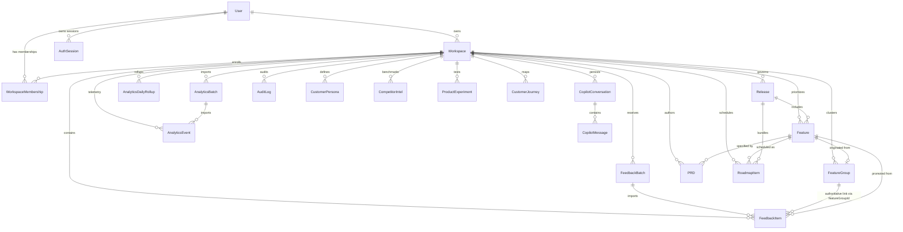

# ProductMind AI — Entity Relationship Documentation

This document defines the entity relationships, cardinalities, authoritative reference keys, and data integrity guarantees for the ProductMind AI database architecture.

---

## 1. High-Level Architecture & Tenancy Model

ProductMind AI uses a **Workspace-Isolated Multi-Tenant Architecture**:
- Global identity is stored in `users`.
- Multi-tenancy is modeled via `workspaces` and `workspace_memberships`.
- All operational records (`feedback_items`, `feature_groups`, `features`, `prds`, `roadmap_items`, `releases`, `analytics_events`, `copilot_conversations`, `audit_logs`) carry an indexed `workspaceId` foreign key.
- A user can belong to multiple workspaces with distinct roles.
- Authorization checks must verify workspace membership before executing any query.

---

## 2. Mermaid Entity Relationship Diagram

---

## 3. Relationship Matrix & Cardinality

| Source Entity | Target Entity | Cardinality | Authoritative Reference Key | Relationship Description & Lifecycle Rules |
|---|---|---|---|---|
| `users` | `workspaces` | `1 : N` | `workspaces.ownerId` | A user can own multiple workspaces. If an owner is deactivated, ownership must be transferred. |
| `users` | `workspaces` | `N : M` | `workspace_memberships.{workspaceId, userId}` | Junction collection enforcing unique user-to-workspace membership and assigned RBAC role. |
| `users` | `auth_sessions` | `1 : N` | `auth_sessions.userId` | Refresh token family tracking. Expired or revoked sessions automatically purge via TTL index. |
| `workspaces` | `feedback_batches` | `1 : N` | `feedback_batches.workspaceId` | Ingestion job tracking metadata. Does not store row payloads. |
| `feedback_batches` | `feedback_items` | `1 : N` | `feedback_items.batchId` | Groups imported records by origin batch. Deleting a batch optionally soft-deletes imported items. |
| `feature_groups` | `feedback_items` | `1 : N` | `feedback_items.featureGroupId` | **Authoritative link**: Feedback items reference their assigned feature group. `feature_groups.feedbackCount` stores a cached counter for zero-join performance. |
| `features` | `feature_groups` | `1 : 1` (Optional) | `features.featureGroupId` | Promoted feature traces back to the originating feedback cluster. |
| `features` | `feedback_items` | `1 : N` (Optional) | `feedback_items.promotedFeatureId` | Direct link from feedback items to the resulting production feature. |
| `features` | `prds` | `1 : N` (1 active) | `prds.featureId` | Each prioritized feature can have Product Requirements Documents. Usually 1 active + historical drafts. |
| `features` | `roadmap_items` | `1 : N` | `roadmap_items.featureId` | A feature may have multiple delivery phases or milestone items on the roadmap. |
| `releases` | `roadmap_items` | `1 : N` | `roadmap_items.releaseId` | Release candidates bundle scheduled roadmap milestone items. |
| `releases` | `features` | `N : M` | `releases.includedFeatureIds` | Release candidate lists features targeted for shipment. Verified by Go/No-Go readiness checklist. |
| `copilot_conversations` | `copilot_messages` | `1 : N` | `copilot_messages.conversationId` | Separate collection for messages prevents unbounded document growth when strategy sessions grow. |
| `workspaces` | `analytics_batches` | `1 : N` | `analytics_batches.workspaceId` | Analytics dataset import job tracking metadata per workspace. |
| `analytics_batches` | `analytics_events` | `1 : N` | `analytics_events.batchId` | Groups imported analytics events by import batch origin. |
| `workspaces` | `analytics_events` | `1 : N` | `analytics_events.workspaceId` | Raw event telemetry stream. Deduplicated per workspace via `eventId`. 90-day TTL retention. |
| `workspaces` | `analytics_daily_rollups` | `1 : N` | `analytics_daily_rollups.workspaceId` | Unique compound index `{ workspaceId: 1, date: 1 }`. Precomputed aggregations for instant dashboard loads. |
| `workspaces` | `audit_logs` | `1 : N` | `audit_logs.workspaceId` | Activity log with `previousState` and `newState` snapshots supporting 1-click reversible undo. |

---

### Decision 1: Feedback Group Membership & Promotion Source of Truth
- **Authoritative Feedback Group Link**: `FeedbackItem.featureGroupId` is the single authoritative source of truth for feedback clustering.
- **Authoritative Feature Origin**: `Feature.featureGroupId` is the authoritative link pointing to the originating `FeatureGroup`. A feature originates from at most one feature cluster.
- **Query Cache Link**: `FeatureGroup.promotedFeatureId` is maintained as a synchronized reference to the promoted `Feature._id` for instant zero-join UI aggregation rendering.
- **Promotion & Merge Semantics**: When two groups are merged, all `FeedbackItem.featureGroupId` references pointing to the source group are atomically repointed to the destination group (`FeedbackItem.updateMany({ featureGroupId: sourceId }, { $set: { featureGroupId: targetId } })`), and cached `feedbackCount` is recomputed (`FeatureGroup.feedbackCount`). When promoted, `Feature.featureGroupId` is written and `FeatureGroup.promotedFeatureId` is updated in a transactional operation.
- **Workspace Scoping Rule**: Feedback, Feature Groups, and Features must belong to the exact same `workspaceId`. Cross-workspace references are strictly rejected at the service validation layer.

### Decision 2: Embedded 13-Section PRD Architecture
- **Decision**: The 13 PRD sections are modeled as an embedded subdocument within the `prds` collection rather than 13 separate collections or unbounded story arrays.
- **Rationale**: A PRD is created, edited, reviewed, printed, and exported as a cohesive specification unit. Embedding eliminates multi-document joins while keeping document size well below 100KB.

### Decision 3: Consistent Release & Roadmap Governance
- **Authoritative Roadmap-to-Feature Link**: `RoadmapItem.featureId` is the authoritative pointer to the backlog feature.
- **Authoritative Roadmap-to-Release Link**: `RoadmapItem.releaseId` is the authoritative assignment linking milestone timeline execution to release governance.
- **Target Release Label on Features**: `Feature.targetRelease` stores a readable release version label (e.g. `'v2.4.0'`) matching `Release.version`. It provides quick visual badging and filter indexing in the Prioritization Matrix without requiring deep joins across roadmap milestones.
- **Release Arrays**: `Release.includedFeatureIds` and `Release.roadmapItemIds` provide indexed lookup for release candidate scope.
- **Release Readiness Quality Gating**:
  - `readinessPercent`: Virtual property computing percentage of completed checklist items (`completed / total * 100`). An empty checklist returns `0%`.
  - `isGated`: Virtual boolean flag. Returns `true` (blocked) if any `required: true` check is not completed, or if the checklist is completely empty. Optional checks (`required: false`) contribute to readiness percentage but do not block `isGated`.
  - Readiness percentage is a governance metric and does not substitute for an explicit sign-off approval state (`Release.status = 'Ready'`).

### Decision 4: Decoupled Copilot Messages
- **Decision**: `copilot_messages` is a standalone collection referencing `copilot_conversations`.
- **Rationale**: Embedding messages directly in conversation documents degrades performance as conversation histories expand. A separate collection allows chronological pagination (`.limit(50).skip(...)`) without transferring the entire conversation tree.
